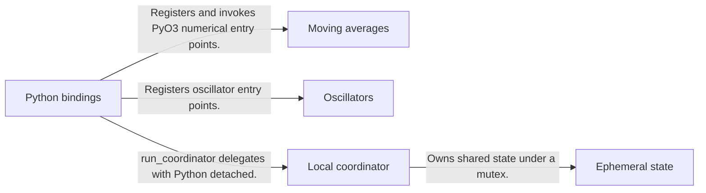
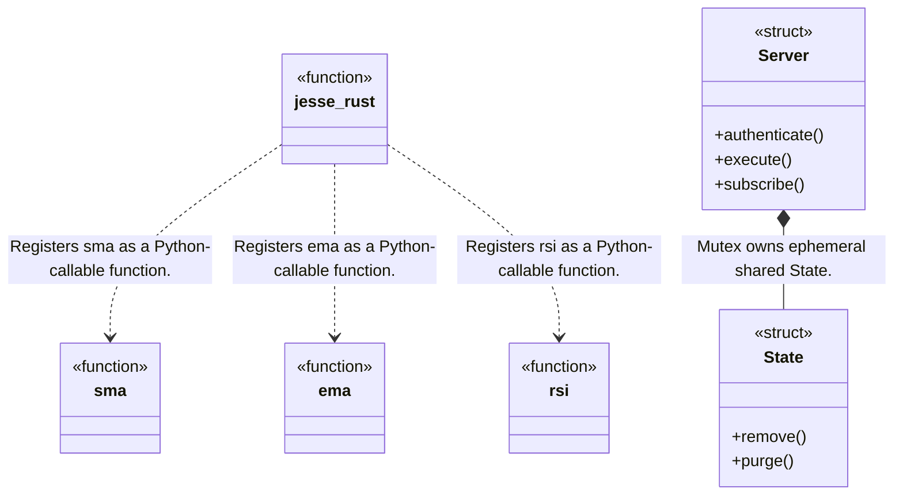
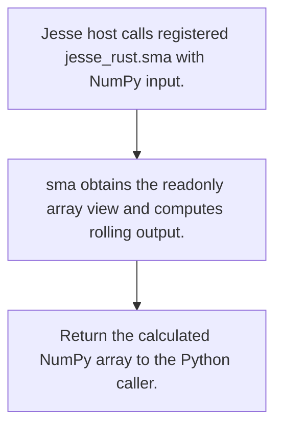
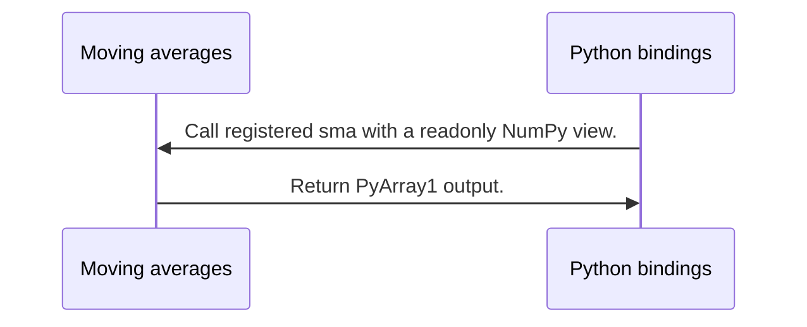

# Jesse Rust: workflow, design and architecture

Updated: **2026-10-13**
Reviewed Git hash: `edb3e71b7ef31ecad3a661e2aaa5e46ccd94a2b4`
Branch: `feature/ayu_develop`
Source diff SHA256: `e3b0c44298fc1c149afbf4c8996fb92427ae41e4649b934ca495991b7852b855`
Scope: **Native host extension** / Maintenance: **companion**
Languages: Rust, Python

[HTML edition](ayu-develop.html) / [Development](development.md) / [Historical validation](validation.md) / [Full system comparison](../../docs/index.html)

## Purpose and scope

PyO3 numerical indicator extension and local in-memory coordination service for the Jesse Python host.

## Features and support boundaries

Native = implemented here. Integration = supplied through a named host/API. Limited = material restriction. Not provided = evidenced scope exclusion. Unverified = support/absence not established. Not applicable = outside this artifact type.

| Capability | Status | Implementation and limits | Source |
|---|---|---|---|
| Backtesting | Not provided | This extension exports numerical kernels and a local coordinator; trading strategy/backtest/broker runtime belongs to the Jesse host. | [jesse_rust](../src/lib.rs) ([L33](https://github.com/alexcwyu/jesse-rust/blob/edb3e71b7ef31ecad3a661e2aaa5e46ccd94a2b4/src/lib.rs#L33)) / [AGENTS.md](../AGENTS.md) ([L6](https://github.com/alexcwyu/jesse-rust/blob/edb3e71b7ef31ecad3a661e2aaa5e46ccd94a2b4/AGENTS.md#L6)) |
| Live execution | Not provided | This extension exports numerical kernels and a local coordinator; trading strategy/backtest/broker runtime belongs to the Jesse host. | [jesse_rust](../src/lib.rs) ([L33](https://github.com/alexcwyu/jesse-rust/blob/edb3e71b7ef31ecad3a661e2aaa5e46ccd94a2b4/src/lib.rs#L33)) / [AGENTS.md](../AGENTS.md) ([L6](https://github.com/alexcwyu/jesse-rust/blob/edb3e71b7ef31ecad3a661e2aaa5e46ccd94a2b4/AGENTS.md#L6)) |
| Paper trading | Not provided | This extension exports numerical kernels and a local coordinator; trading strategy/backtest/broker runtime belongs to the Jesse host. | [jesse_rust](../src/lib.rs) ([L33](https://github.com/alexcwyu/jesse-rust/blob/edb3e71b7ef31ecad3a661e2aaa5e46ccd94a2b4/src/lib.rs#L33)) / [AGENTS.md](../AGENTS.md) ([L6](https://github.com/alexcwyu/jesse-rust/blob/edb3e71b7ef31ecad3a661e2aaa5e46ccd94a2b4/AGENTS.md#L6)) |
| Event driven | Limited | Coordinator provides bounded local pub/sub and shared-state RPC; no strategy engine event dispatcher is exposed here. | [Server](../coordination/src/lib.rs) ([L160](https://github.com/alexcwyu/jesse-rust/blob/edb3e71b7ef31ecad3a661e2aaa5e46ccd94a2b4/coordination/src/lib.rs#L160)) / [run](../coordination/src/lib.rs) ([L779](https://github.com/alexcwyu/jesse-rust/blob/edb3e71b7ef31ecad3a661e2aaa5e46ccd94a2b4/coordination/src/lib.rs#L779)) |
| Vectorized | Limited | Consumes/returns NumPy series; kernels loop sequentially in Rust. This is array computation, not a vectorized portfolio backtester. | [sma](../src/moving_averages.rs) ([L108](https://github.com/alexcwyu/jesse-rust/blob/edb3e71b7ef31ecad3a661e2aaa5e46ccd94a2b4/src/moving_averages.rs#L108)) / [ema](../src/moving_averages.rs) ([L350](https://github.com/alexcwyu/jesse-rust/blob/edb3e71b7ef31ecad3a661e2aaa5e46ccd94a2b4/src/moving_averages.rs#L350)) |
| Order management | Unverified | Not established by the inspected implementation boundaries; no absence or production claim is made. | Not applicable to this repository scope. |
| Order types | Unverified | Not established by the inspected implementation boundaries; no absence or production claim is made. | Not applicable to this repository scope. |
| Multi venue | Unverified | Not established by the inspected implementation boundaries; no absence or production claim is made. | Not applicable to this repository scope. |
| Crypto | Unverified | Not established by the inspected implementation boundaries; no absence or production claim is made. | Not applicable to this repository scope. |
| Equities | Unverified | Not established by the inspected implementation boundaries; no absence or production claim is made. | Not applicable to this repository scope. |
| Futures | Unverified | Not established by the inspected implementation boundaries; no absence or production claim is made. | Not applicable to this repository scope. |
| Options | Unverified | Not established by the inspected implementation boundaries; no absence or production claim is made. | Not applicable to this repository scope. |
| Forex | Unverified | Not established by the inspected implementation boundaries; no absence or production claim is made. | Not applicable to this repository scope. |
| Strategy api | Not provided | This extension exports numerical kernels and a local coordinator; trading strategy/backtest/broker runtime belongs to the Jesse host. | [jesse_rust](../src/lib.rs) ([L33](https://github.com/alexcwyu/jesse-rust/blob/edb3e71b7ef31ecad3a661e2aaa5e46ccd94a2b4/src/lib.rs#L33)) / [AGENTS.md](../AGENTS.md) ([L6](https://github.com/alexcwyu/jesse-rust/blob/edb3e71b7ef31ecad3a661e2aaa5e46ccd94a2b4/AGENTS.md#L6)) |
| Optimization | Unverified | Not established by the inspected implementation boundaries; no absence or production claim is made. | Not applicable to this repository scope. |
| Machine learning | Unverified | Not established by the inspected implementation boundaries; no absence or production claim is made. | Not applicable to this repository scope. |
| Reinforcement learning | Unverified | Not established by the inspected implementation boundaries; no absence or production claim is made. | Not applicable to this repository scope. |
| Portfolio | Unverified | Not established by the inspected implementation boundaries; no absence or production claim is made. | Not applicable to this repository scope. |
| Risk management | Unverified | Not established by the inspected implementation boundaries; no absence or production claim is made. | Not applicable to this repository scope. |
| Performance analytics | Unverified | Not established by the inspected implementation boundaries; no absence or production claim is made. | Not applicable to this repository scope. |
| Historical data | Unverified | Not established by the inspected implementation boundaries; no absence or production claim is made. | Not applicable to this repository scope. |
| Streaming data | Unverified | Not established by the inspected implementation boundaries; no absence or production claim is made. | Not applicable to this repository scope. |
| Persistence | Not provided | Coordinator intentionally keeps State in memory and changes generation across restarts; this is not durable persistence. | [State](../coordination/src/lib.rs) ([L113](https://github.com/alexcwyu/jesse-rust/blob/edb3e71b7ef31ecad3a661e2aaa5e46ccd94a2b4/coordination/src/lib.rs#L113)) / [run](../coordination/src/lib.rs) ([L779](https://github.com/alexcwyu/jesse-rust/blob/edb3e71b7ef31ecad3a661e2aaa5e46ccd94a2b4/coordination/src/lib.rs#L779)) |
| Data pipeline | Unverified | Not established by the inspected implementation boundaries; no absence or production claim is made. | Not applicable to this repository scope. |
| Web ui | Unverified | Not established by the inspected implementation boundaries; no absence or production claim is made. | Not applicable to this repository scope. |
| Cli | Unverified | Not established by the inspected implementation boundaries; no absence or production claim is made. | Not applicable to this repository scope. |
| Monitoring | Unverified | Not established by the inspected implementation boundaries; no absence or production claim is made. | Not applicable to this repository scope. |
| Extension api | Native | PyO3 module exposes actual Rust indicator kernels to Python. | [jesse_rust](../src/lib.rs) ([L33](https://github.com/alexcwyu/jesse-rust/blob/edb3e71b7ef31ecad3a661e2aaa5e46ccd94a2b4/src/lib.rs#L33)) / [sma](../src/moving_averages.rs) ([L108](https://github.com/alexcwyu/jesse-rust/blob/edb3e71b7ef31ecad3a661e2aaa5e46ccd94a2b4/src/moving_averages.rs#L108)) / [ema](../src/moving_averages.rs) ([L350](https://github.com/alexcwyu/jesse-rust/blob/edb3e71b7ef31ecad3a661e2aaa5e46ccd94a2b4/src/moving_averages.rs#L350)) / [rsi](../src/oscillators.rs) ([L19](https://github.com/alexcwyu/jesse-rust/blob/edb3e71b7ef31ecad3a661e2aaa5e46ccd94a2b4/src/oscillators.rs#L19)) |
| Native acceleration | Native | PyO3 module exposes actual Rust indicator kernels to Python. | [jesse_rust](../src/lib.rs) ([L33](https://github.com/alexcwyu/jesse-rust/blob/edb3e71b7ef31ecad3a661e2aaa5e46ccd94a2b4/src/lib.rs#L33)) / [sma](../src/moving_averages.rs) ([L108](https://github.com/alexcwyu/jesse-rust/blob/edb3e71b7ef31ecad3a661e2aaa5e46ccd94a2b4/src/moving_averages.rs#L108)) / [ema](../src/moving_averages.rs) ([L350](https://github.com/alexcwyu/jesse-rust/blob/edb3e71b7ef31ecad3a661e2aaa5e46ccd94a2b4/src/moving_averages.rs#L350)) / [rsi](../src/oscillators.rs) ([L19](https://github.com/alexcwyu/jesse-rust/blob/edb3e71b7ef31ecad3a661e2aaa5e46ccd94a2b4/src/oscillators.rs#L19)) |
| Distributed execution | Limited | Local-only authenticated coordination for host processes; loopback bind restriction prevents distributed network deployment. | [run](../coordination/src/lib.rs) ([L779](https://github.com/alexcwyu/jesse-rust/blob/edb3e71b7ef31ecad3a661e2aaa5e46ccd94a2b4/coordination/src/lib.rs#L779)) |

## System components

| Component | Responsibility | Source |
|---|---|---|
| Python bindings | Exports module functions and converts error/return types. | [jesse_rust](../src/lib.rs) ([L33](https://github.com/alexcwyu/jesse-rust/blob/edb3e71b7ef31ecad3a661e2aaa5e46ccd94a2b4/src/lib.rs#L33)) / [run_coordinator](../src/lib.rs) ([L13](https://github.com/alexcwyu/jesse-rust/blob/edb3e71b7ef31ecad3a661e2aaa5e46ccd94a2b4/src/lib.rs#L13)) |
| Moving averages | Computes rolling and recursive averages over NumPy input. | [sma](../src/moving_averages.rs) ([L108](https://github.com/alexcwyu/jesse-rust/blob/edb3e71b7ef31ecad3a661e2aaa5e46ccd94a2b4/src/moving_averages.rs#L108)) / [ema](../src/moving_averages.rs) ([L350](https://github.com/alexcwyu/jesse-rust/blob/edb3e71b7ef31ecad3a661e2aaa5e46ccd94a2b4/src/moving_averages.rs#L350)) |
| Oscillators | Computes RSI and related oscillator arrays. | [rsi](../src/oscillators.rs) ([L19](https://github.com/alexcwyu/jesse-rust/blob/edb3e71b7ef31ecad3a661e2aaa5e46ccd94a2b4/src/oscillators.rs#L19)) |
| Local coordinator | Hosts authenticated bounded state and pub/sub for the host. | [Server](../coordination/src/lib.rs) ([L160](https://github.com/alexcwyu/jesse-rust/blob/edb3e71b7ef31ecad3a661e2aaa5e46ccd94a2b4/coordination/src/lib.rs#L160)) / [run](../coordination/src/lib.rs) ([L779](https://github.com/alexcwyu/jesse-rust/blob/edb3e71b7ef31ecad3a661e2aaa5e46ccd94a2b4/coordination/src/lib.rs#L779)) |
| Ephemeral state | Stores keys, locks and subscriber state until expiry/restart. | [State](../coordination/src/lib.rs) ([L113](https://github.com/alexcwyu/jesse-rust/blob/edb3e71b7ef31ecad3a661e2aaa5e46ccd94a2b4/coordination/src/lib.rs#L113)) |

## Architecture and component boundaries

The component view summarizes inspected responsibility boundaries. Arrows identify the documented API/data dependencies; this is not a deployment-readiness claim.

- Registers and invokes PyO3 numerical entry points.: [jesse_rust](../src/lib.rs) ([L33](https://github.com/alexcwyu/jesse-rust/blob/edb3e71b7ef31ecad3a661e2aaa5e46ccd94a2b4/src/lib.rs#L33)) / [sma](../src/moving_averages.rs) ([L108](https://github.com/alexcwyu/jesse-rust/blob/edb3e71b7ef31ecad3a661e2aaa5e46ccd94a2b4/src/moving_averages.rs#L108))
- Registers oscillator entry points.: [jesse_rust](../src/lib.rs) ([L33](https://github.com/alexcwyu/jesse-rust/blob/edb3e71b7ef31ecad3a661e2aaa5e46ccd94a2b4/src/lib.rs#L33)) / [rsi](../src/oscillators.rs) ([L19](https://github.com/alexcwyu/jesse-rust/blob/edb3e71b7ef31ecad3a661e2aaa5e46ccd94a2b4/src/oscillators.rs#L19))
- run_coordinator delegates with Python detached.: [run_coordinator](../src/lib.rs) ([L13](https://github.com/alexcwyu/jesse-rust/blob/edb3e71b7ef31ecad3a661e2aaa5e46ccd94a2b4/src/lib.rs#L13)) / [run](../coordination/src/lib.rs) ([L779](https://github.com/alexcwyu/jesse-rust/blob/edb3e71b7ef31ecad3a661e2aaa5e46ccd94a2b4/coordination/src/lib.rs#L779))
- Owns shared state under a mutex.: [Server](../coordination/src/lib.rs) ([L160](https://github.com/alexcwyu/jesse-rust/blob/edb3e71b7ef31ecad3a661e2aaa5e46ccd94a2b4/coordination/src/lib.rs#L160)) / [State](../coordination/src/lib.rs) ([L113](https://github.com/alexcwyu/jesse-rust/blob/edb3e71b7ef31ecad3a661e2aaa5e46ccd94a2b4/coordination/src/lib.rs#L113))

## Design decisions

| Decision | Rationale | Tradeoff | Evidence |
|---|---|---|---|
| Keep numerical kernels behind PyO3 NumPy bindings. | Python host retains orchestration while Rust computes array results. | Caller must respect each indicator warmup/empty-input contract. | [jesse_rust](../src/lib.rs) ([L33](https://github.com/alexcwyu/jesse-rust/blob/edb3e71b7ef31ecad3a661e2aaa5e46ccd94a2b4/src/lib.rs#L33)) / [sma](../src/moving_averages.rs) ([L108](https://github.com/alexcwyu/jesse-rust/blob/edb3e71b7ef31ecad3a661e2aaa5e46ccd94a2b4/src/moving_averages.rs#L108)) / [rsi](../src/oscillators.rs) ([L19](https://github.com/alexcwyu/jesse-rust/blob/edb3e71b7ef31ecad3a661e2aaa5e46ccd94a2b4/src/oscillators.rs#L19)) |
| Use bounded local ephemeral coordination. | Token auth, loopback-only binding and restart generations bound access and prevent silent stale-state continuation. | State is lost on restart; this is not a durable or remote distributed service. | [run](../coordination/src/lib.rs) ([L779](https://github.com/alexcwyu/jesse-rust/blob/edb3e71b7ef31ecad3a661e2aaa5e46ccd94a2b4/coordination/src/lib.rs#L779)) / [State](../coordination/src/lib.rs) ([L113](https://github.com/alexcwyu/jesse-rust/blob/edb3e71b7ef31ecad3a661e2aaa5e46ccd94a2b4/coordination/src/lib.rs#L113)) |

## Class and interface relationships

Each node is a reviewed source symbol. Function/module nodes are explicitly labeled; they do not imply Python classes. Only reviewed relationships are drawn.

- **jesse_rust** (function): [jesse_rust](../src/lib.rs) ([L33](https://github.com/alexcwyu/jesse-rust/blob/edb3e71b7ef31ecad3a661e2aaa5e46ccd94a2b4/src/lib.rs#L33))
- **sma** (function): [sma](../src/moving_averages.rs) ([L108](https://github.com/alexcwyu/jesse-rust/blob/edb3e71b7ef31ecad3a661e2aaa5e46ccd94a2b4/src/moving_averages.rs#L108))
- **ema** (function): [ema](../src/moving_averages.rs) ([L350](https://github.com/alexcwyu/jesse-rust/blob/edb3e71b7ef31ecad3a661e2aaa5e46ccd94a2b4/src/moving_averages.rs#L350))
- **rsi** (function): [rsi](../src/oscillators.rs) ([L19](https://github.com/alexcwyu/jesse-rust/blob/edb3e71b7ef31ecad3a661e2aaa5e46ccd94a2b4/src/oscillators.rs#L19))
- **Server** (struct): [Server](../coordination/src/lib.rs) ([L160](https://github.com/alexcwyu/jesse-rust/blob/edb3e71b7ef31ecad3a661e2aaa5e46ccd94a2b4/coordination/src/lib.rs#L160))
- **State** (struct): [State](../coordination/src/lib.rs) ([L113](https://github.com/alexcwyu/jesse-rust/blob/edb3e71b7ef31ecad3a661e2aaa5e46ccd94a2b4/coordination/src/lib.rs#L113))

## Workflow

### Host indicator invocation

The Jesse host is an external participant; its trading workflow is not implemented or independently audited in this repository. The numerical call/return is read directly here.

1. Jesse host calls registered jesse_rust.sma with NumPy input.. [AGENTS.md](../AGENTS.md) ([L6](https://github.com/alexcwyu/jesse-rust/blob/edb3e71b7ef31ecad3a661e2aaa5e46ccd94a2b4/AGENTS.md#L6)) / [jesse_rust](../src/lib.rs) ([L33](https://github.com/alexcwyu/jesse-rust/blob/edb3e71b7ef31ecad3a661e2aaa5e46ccd94a2b4/src/lib.rs#L33))
2. sma obtains the readonly array view and computes rolling output.. [sma](../src/moving_averages.rs) ([L108](https://github.com/alexcwyu/jesse-rust/blob/edb3e71b7ef31ecad3a661e2aaa5e46ccd94a2b4/src/moving_averages.rs#L108))
3. Return the calculated NumPy array to the Python caller.. [sma](../src/moving_averages.rs) ([L108](https://github.com/alexcwyu/jesse-rust/blob/edb3e71b7ef31ecad3a661e2aaa5e46ccd94a2b4/src/moving_averages.rs#L108))

## Sequence

Host indicator invocation

The Jesse host is an external participant; its trading workflow is not implemented or independently audited in this repository. The numerical call/return is read directly here.

- Call registered sma with a readonly NumPy view.: [jesse_rust](../src/lib.rs) ([L33](https://github.com/alexcwyu/jesse-rust/blob/edb3e71b7ef31ecad3a661e2aaa5e46ccd94a2b4/src/lib.rs#L33)) / [sma](../src/moving_averages.rs) ([L108](https://github.com/alexcwyu/jesse-rust/blob/edb3e71b7ef31ecad3a661e2aaa5e46ccd94a2b4/src/moving_averages.rs#L108))
- Return PyArray1 output.: [sma](../src/moving_averages.rs) ([L108](https://github.com/alexcwyu/jesse-rust/blob/edb3e71b7ef31ecad3a661e2aaa5e46ccd94a2b4/src/moving_averages.rs#L108))

## Strengths and limits

### Strengths

- Actual rolling/recursive indicator bodies are exposed through a small Python-native boundary. [sma](../src/moving_averages.rs) ([L108](https://github.com/alexcwyu/jesse-rust/blob/edb3e71b7ef31ecad3a661e2aaa5e46ccd94a2b4/src/moving_averages.rs#L108)) / [ema](../src/moving_averages.rs) ([L350](https://github.com/alexcwyu/jesse-rust/blob/edb3e71b7ef31ecad3a661e2aaa5e46ccd94a2b4/src/moving_averages.rs#L350)) / [rsi](../src/oscillators.rs) ([L19](https://github.com/alexcwyu/jesse-rust/blob/edb3e71b7ef31ecad3a661e2aaa5e46ccd94a2b4/src/oscillators.rs#L19))

### Limitations

- Market coverage, broker execution, optimizer and trading risk policy are host responsibilities; they cannot be credited as native engine capabilities here. [AGENTS.md](../AGENTS.md) ([L6](https://github.com/alexcwyu/jesse-rust/blob/edb3e71b7ef31ecad3a661e2aaa5e46ccd94a2b4/AGENTS.md#L6)) / [jesse_rust](../src/lib.rs) ([L33](https://github.com/alexcwyu/jesse-rust/blob/edb3e71b7ef31ecad3a661e2aaa5e46ccd94a2b4/src/lib.rs#L33))

## Validation scope

The linked validation and command records preserve actual historical runs and user-authorized exclusions. This source/document review does not rerun application tests, establish live trading readiness or rank benchmark performance. Current data, credential and runtime prerequisites remain material.

[Repository validation](validation.md) / [Executed checks](maintenance/index.md)

## Source map

| Reviewed symbol/path | Inspected responsibility | Actual file SHA256 |
|---|---|---|
| [jesse_rust](../src/lib.rs) ([L33](https://github.com/alexcwyu/jesse-rust/blob/edb3e71b7ef31ecad3a661e2aaa5e46ccd94a2b4/src/lib.rs#L33)) | Registers indicator functions and run_coordinator into the Python module; no broker or strategy event loop is registered. | `a17ff60af3bcfa127b265bcb4a6c709173039ee063c17504e68cf6cbf8d0c04a` |
| [sma](../src/moving_averages.rs) ([L108](https://github.com/alexcwyu/jesse-rust/blob/edb3e71b7ef31ecad3a661e2aaa5e46ccd94a2b4/src/moving_averages.rs#L108)) | Reads a NumPy view, initializes NaN output, performs rolling sum/count updates and returns a NumPy array. | `476d9ee9f185c24a8582c9c7fc985c64d80e33ce94e6f31d90288e81de1d1c9f` |
| [ema](../src/moving_averages.rs) ([L350](https://github.com/alexcwyu/jesse-rust/blob/edb3e71b7ef31ecad3a661e2aaa5e46ccd94a2b4/src/moving_averages.rs#L350)) | Uses the input first value and explicit alpha recurrence to compute an output series; empty and insufficient input return initialized arrays. | `476d9ee9f185c24a8582c9c7fc985c64d80e33ce94e6f31d90288e81de1d1c9f` |
| [rsi](../src/oscillators.rs) ([L19](https://github.com/alexcwyu/jesse-rust/blob/edb3e71b7ef31ecad3a661e2aaa5e46ccd94a2b4/src/oscillators.rs#L19)) | Builds initial gains/losses and Wilder smoothing with NaN warmup and zero-loss handling. | `9016a8f4d1cc3885c5ddb548ac2a14cd7de2397d3b158159179d800f66871b47` |
| [run_coordinator](../src/lib.rs) ([L13](https://github.com/alexcwyu/jesse-rust/blob/edb3e71b7ef31ecad3a661e2aaa5e46ccd94a2b4/src/lib.rs#L13)) | Detaches the Python thread while calling jesse_coordinator::run and translates failures to PyRuntimeError. | `a17ff60af3bcfa127b265bcb4a6c709173039ee063c17504e68cf6cbf8d0c04a` |
| [Server](../coordination/src/lib.rs) ([L160](https://github.com/alexcwyu/jesse-rust/blob/edb3e71b7ef31ecad3a661e2aaa5e46ccd94a2b4/coordination/src/lib.rs#L160)) | Owns Mutex-protected State, token, restart generation and bounded client/event accounting; authenticate/execute/subscribe implement the local protocol. | `1d313546669a850fe400130c04445f084d3c7b34f96e83c35c0c17f927b5ee53` |
| [run](../coordination/src/lib.rs) ([L779](https://github.com/alexcwyu/jesse-rust/blob/edb3e71b7ef31ecad3a661e2aaa5e46ccd94a2b4/coordination/src/lib.rs#L779)) | Requires token length >=32, refuses non-loopback bind addresses, supervises parent stdin EOF and creates a new generation on restart. | `1d313546669a850fe400130c04445f084d3c7b34f96e83c35c0c17f927b5ee53` |
| [State](../coordination/src/lib.rs) ([L113](https://github.com/alexcwyu/jesse-rust/blob/edb3e71b7ef31ecad3a661e2aaa5e46ccd94a2b4/coordination/src/lib.rs#L113)) | Holds entries, byte accounting and subscribers in memory; purge removes expired entries and dead subscribers. | `1d313546669a850fe400130c04445f084d3c7b34f96e83c35c0c17f927b5ee53` |
| [AGENTS.md](../AGENTS.md) ([L6](https://github.com/alexcwyu/jesse-rust/blob/edb3e71b7ef31ecad3a661e2aaa5e46ccd94a2b4/AGENTS.md#L6)) | Repository instructions identify performance implementations consumed by Jesse through PyO3. | `f32ebe94da2bcbe0a87df5c281560b79f5a46be39426a10bc4fc4447a93c6378` |

## Documentation provenance

Review date: 2026-10-13. Full committed source HEAD: `edb3e71b7ef31ecad3a661e2aaa5e46ccd94a2b4`. Template version: 2. 5 source files were independently hashed for this guide.

[Evidence catalog](../../docs/systems-2026-10-13/catalog.json) / [Standard template](../../docs/guidelines/APP_TEMPLATE.md)

- Inspected source paths: src/lib.rs, src/moving_averages.rs, src/oscillators.rs, coordination/src/lib.rs, AGENTS.md
- Read-only audit against the full HEAD and tracked-diff provenance in inventory.json. Validation documentation is historical executed evidence; exclusions are completion policy, not live venue proof. No dependencies, tests or upstream files were changed.
