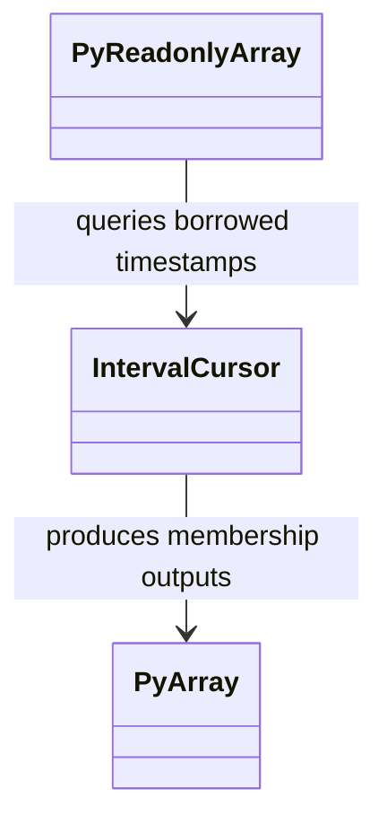
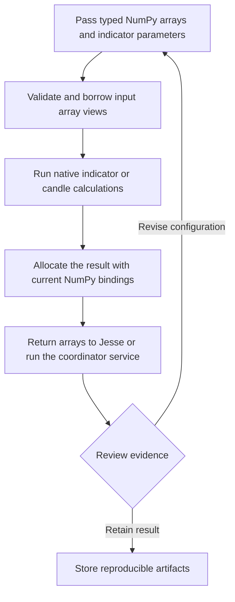
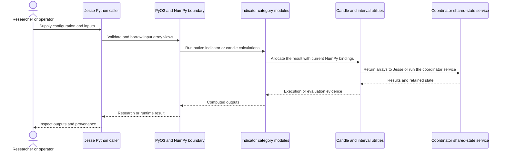
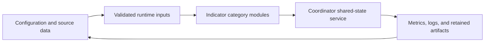
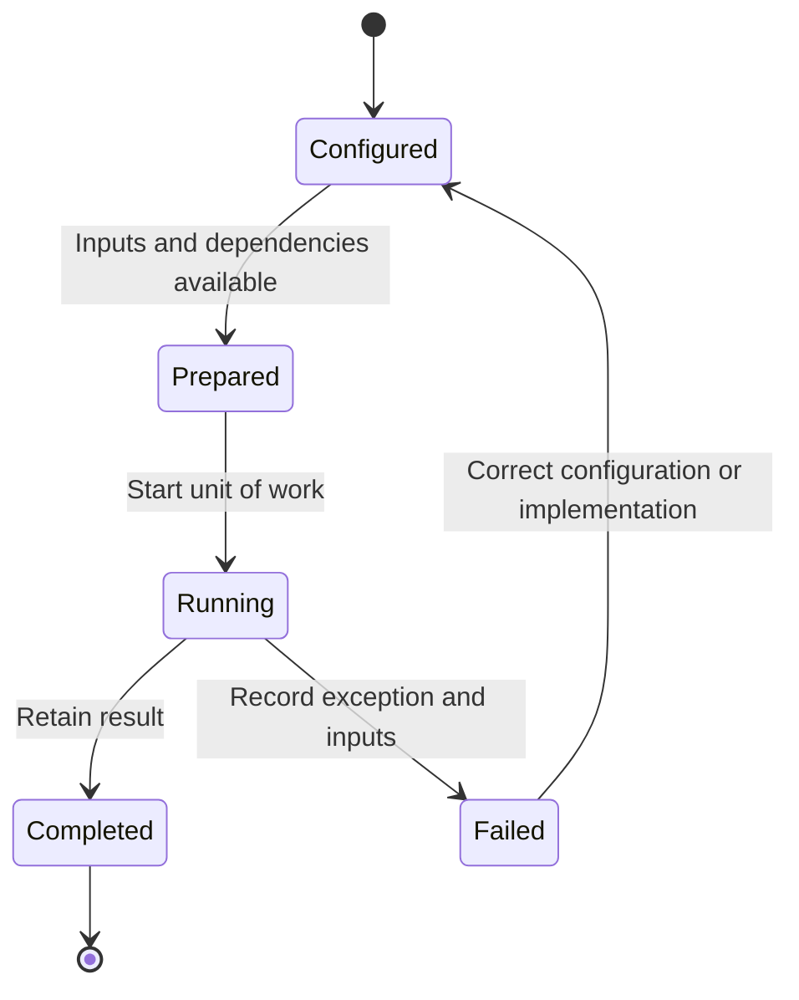

# Jesse Rust: workflow and architecture

Updated 2026-10-12. Source baseline: `eb3e839e5956631e9e93a0284c41816db1b5e67a` on `feature/ayu_develop`. See [development commands](development.md) and [validation evidence](validation.md) for the tested environment and current limitations.

## Purpose and features

Supplies native technical indicators, candle transforms, trading-session filtering, and the shared-state coordinator used by the Jesse Python trading framework.

- Moving averages and oscillators
- Bands, trend, volume, and statistical functions
- Candle aggregation and gap correction
- Trading-hours masks and interval filtering
- Native shared-state coordinator

## Component architecture

Indicator categories keep numerical kernels organized while the module entry point registers the Python functions. PyReadonlyArray exposes borrowed input views and returned PyArray objects own the numerical results. IntervalCursor accelerates neighboring session queries while retaining behavior for unordered and strided timestamps. Candle operations document accumulation and NaN semantics, so a bindings upgrade must preserve those numerical contracts. The coordinator is a separate native service invoked from the Python module with the interpreter detached.

The diagram shows responsibility boundaries in the main research or execution path. Concrete entry points and implementation files are linked below.

## Core types

The types below belong to the public or native boundary described by the linked implementation. Arrows describe the dependency or ownership relationship used in the documented workflow. Listed Python methods are present in the linked source; native array types represent the binding boundary.

## End-to-end workflow

1. Pass typed NumPy arrays and indicator parameters.
2. Validate and borrow input array views.
3. Run native indicator or candle calculations.
4. Allocate the result with current NumPy bindings.
5. Return arrays to Jesse or run the coordinator service.

## Interaction sequence

The sequence follows one unit of work. Results return across the same boundaries that accepted the configuration and data. External I/O and numerical execution have different failure modes and should retain separate evidence.

## Data and artifact lifecycle

Inputs include explicit strategy or model settings, data selection, and execution assumptions. Retaining these with outputs makes a rerun reviewable. Temporary environments and caches remain development artifacts, while source-controlled configuration documents intended behavior.

## Execution and failure boundaries

The Python extension requires Rust, maturin, PyO3, and matching NumPy Rust bindings. Jesse integration tests live in the sibling Jesse repository and exercise the exported functions through their real callers. This repository also contains the coordinator crate and its own tests. The maintenance changes binding ownership APIs without changing indicator algorithms.

This state diagram describes the documented workflow, not a claim that these names are an implementation enum. Failure evidence should identify whether input preparation, external services, native compilation, or application execution failed.

## Development layout

The native src/ modules and coordination/ crate remain in place. maturin uses the root Cargo manifest and locked native dependencies. The interpreter and Python development dependencies are recorded in .python-version and uv.lock.

## Source map

| Existing source | Responsibility evidence |
|---|---|
| [src/lib.rs](../src/lib.rs#L1) | Implementation and module/type documentation, beginning at line 1 |
| [src/moving_averages.rs](../src/moving_averages.rs#L12) | Implementation and module/type documentation, beginning at line 12 |
| [src/oscillators.rs](../src/oscillators.rs#L19) | Implementation and module/type documentation, beginning at line 19 |
| [src/bands.rs](../src/bands.rs#L14) | Implementation and module/type documentation, beginning at line 14 |
| [src/trend.rs](../src/trend.rs#L12) | Implementation and module/type documentation, beginning at line 12 |
| [src/volume.rs](../src/volume.rs#L11) | Implementation and module/type documentation, beginning at line 11 |
| [src/statistical.rs](../src/statistical.rs#L12) | Implementation and module/type documentation, beginning at line 12 |
| [src/ehlers.rs](../src/ehlers.rs#L11) | Implementation and module/type documentation, beginning at line 11 |
| [src/candle.rs](../src/candle.rs#L95) | Implementation and module/type documentation, beginning at line 95 |
| [src/trading_hours.rs](../src/trading_hours.rs#L47) | Implementation and module/type documentation, beginning at line 47 |
| [src/helpers.rs](../src/helpers.rs#L1) | Implementation and module/type documentation, beginning at line 1 |
| [src/types.rs](../src/types.rs#L1) | Implementation and module/type documentation, beginning at line 1 |
| [coordination/src/lib.rs](../coordination/src/lib.rs#L779) | Implementation and module/type documentation, beginning at line 779 |
| [Cargo.toml](../Cargo.toml#L1) | Implementation and module/type documentation, beginning at line 1 |
| [pyproject.toml](../pyproject.toml#L5) | Implementation and module/type documentation, beginning at line 5 |

The links target files present in this checkout. Follow their imports and adjacent tests when changing a boundary. The validation document distinguishes successful builds, complete test runs, inherited skips, and unresolved prerequisites.
